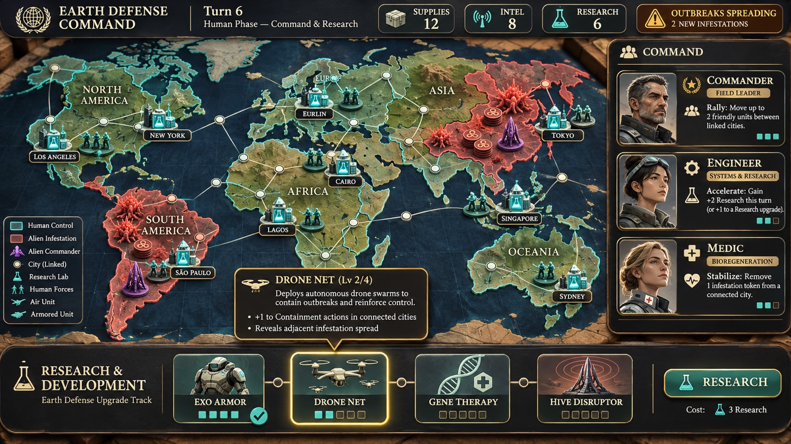
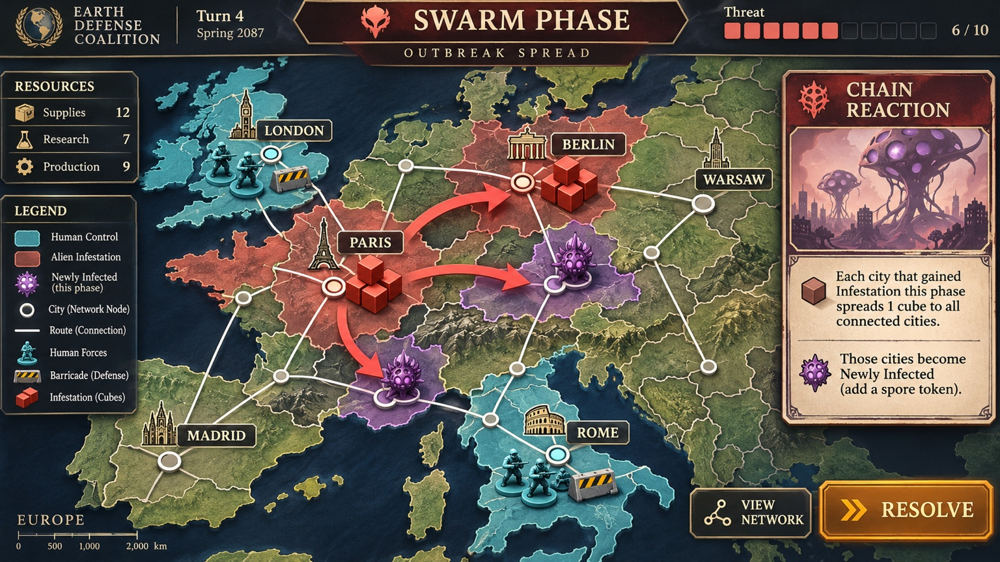
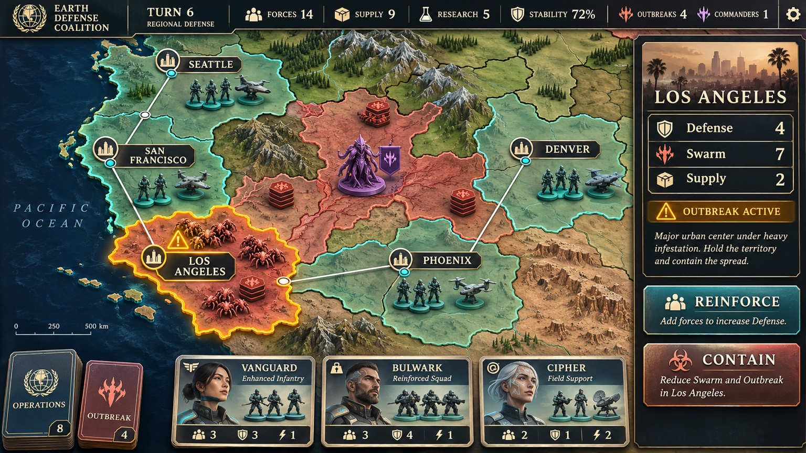
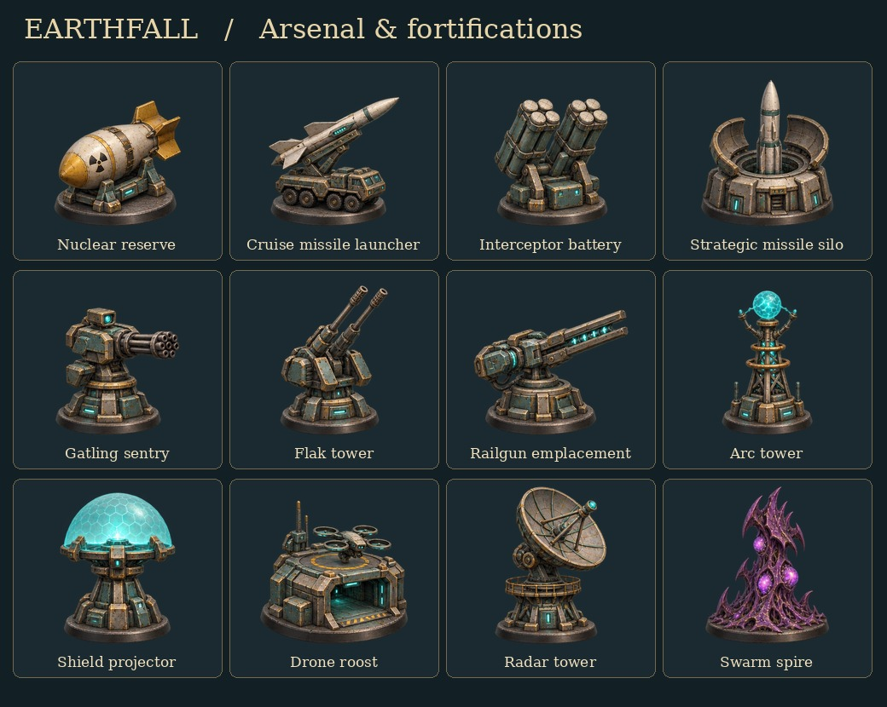

# Earthfall visual direction

Earthfall takes place about 50–100 years from now. The player commands an enhanced human coalition against a spreading alien swarm from above a painted strategy board. The three original compositions below are the visual reference for new screens, artwork and motion.

## World command and research

Keep the world readable at a glance. The continents have slightly exaggerated silhouettes and the board feels gently bowed. Thin illuminated coastlines and short shadows make the land look carved. Use navy water, sage forests, warm tan deserts and pale ice. Carry those materials onto the globe. Keep the world artwork clean so the engine can place ownership, borders, routes, labels and pieces at each zoom level.

Frame the board with dark enamel, worn brass edges and warm ivory serif lettering. Give resources a quiet top bar, field leaders a portrait rail, and research cards a bottom tray. The selected card has the clearest gold highlight. Preserve this order of attention on a phone by letting long panels collapse.

## Swarm phase and outbreak spread

An outbreak should read as a sequence. Hold on the origin, animate spread along its connected routes, then reveal the new infestation tokens at the destinations. Keep existing links thin and ivory. Give the active spread arrow a broad coral silhouette. Violet spores and red cubes distinguish a new infection from accumulated pressure even at small sizes. Use the illustrated event card for the rule and consequence.

## Regional defense and battle

Regional zoom reveals ridgelines, forest clusters and the bases under the miniatures. Keep lighting consistent, with a warm key from the upper left and soft contact shadows toward the lower right. Human structures use teal enamel and dark metal. The swarm uses coral chitin and violet growths. Put a gold rim on the selected territory and anchor city labels to network nodes. Give the player the local defense, swarm and supply figures beside the board.

Use distinct silhouettes for towers and weapons. Let recoil, a short visible shot and a localized impact explain which tower hit which unit. Ease camera movement into a regional encounter, keep the player's target in view, and let press feedback settle quickly. Use the existing reduced-motion behavior for camera transitions and decorative effects.

## Applying the guide

Use the original screenshots above for composition, terrain and lighting. The arsenal sheet illustrates how new pieces fit that direction. Use the reviewed theme palette for labels, factions and interactive states. Keep live values, text and hit targets independent of painted art. When reviewing a visual change, compare the same scene at world and regional scale: the selected location, opposing factions and available action should each remain identifiable.
