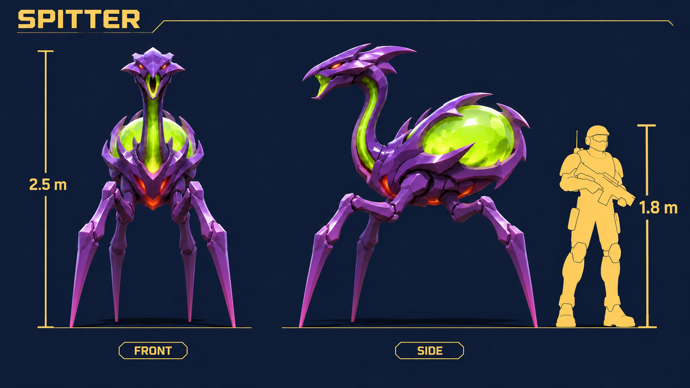
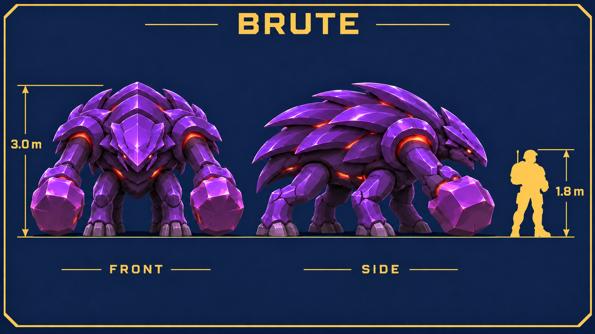
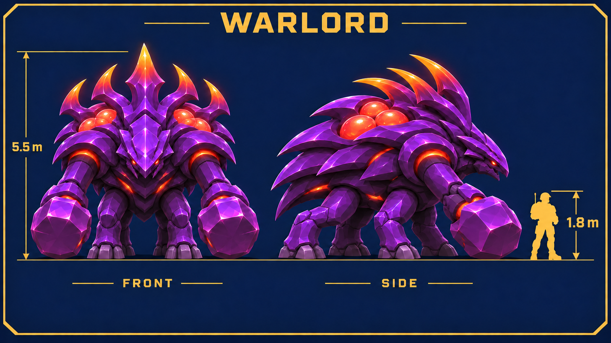
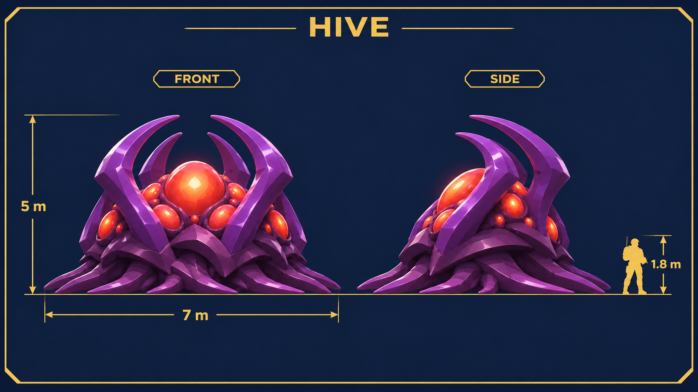
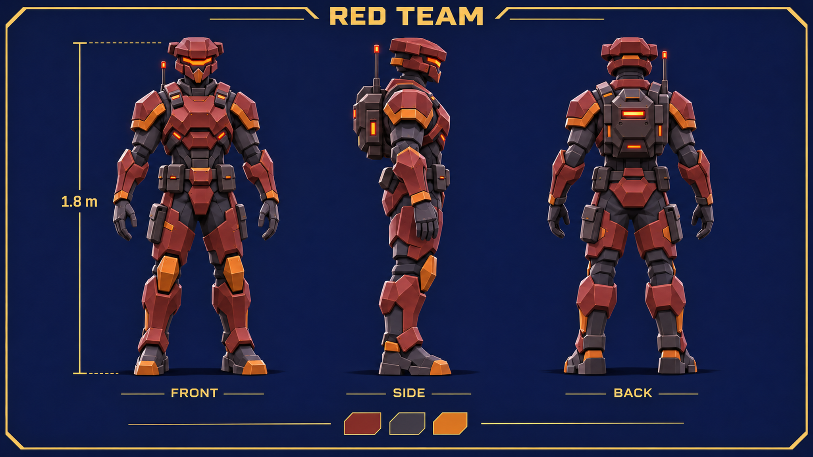
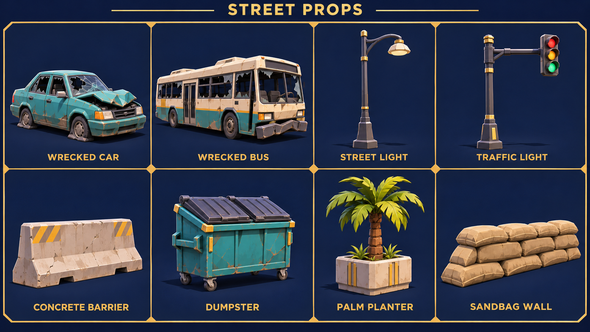
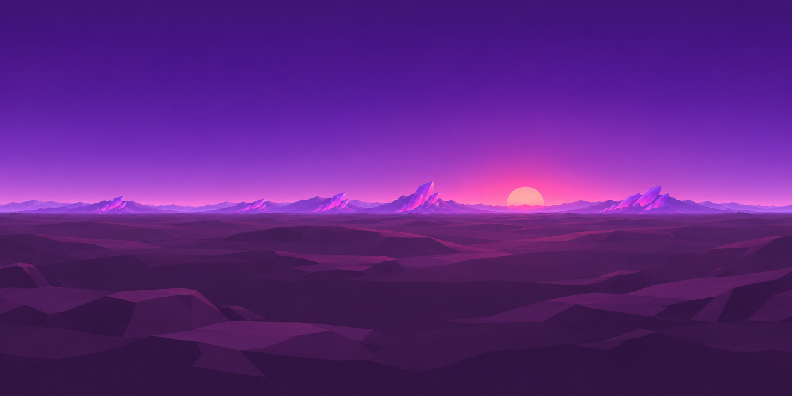
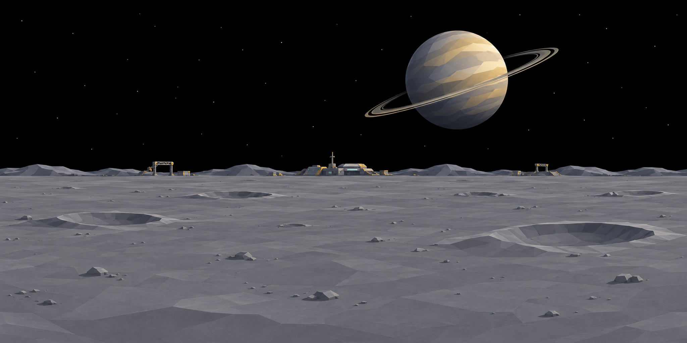
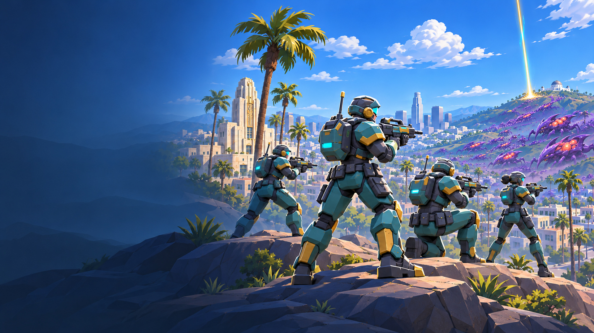

# Frontline round 2 art

Original concept sheets and environment artwork for [issue #34](https://github.com/NationalSports/earthfall/issues/34), created with the built-in ImageGen tool using [style-sheet.png](style-sheet.png) as the visual reference. No third-party characters, meshes, logos or source imagery were used. These are modeling references and color textures. The issue is the authority for delivery paths and sizes.

## Modeling sheets

All six sheets are 2048×1152 PNGs. The four swarm sheets show front and side views on navy with a gold soldier scale silhouette. Use the annotated meter values as modeling targets; these are concept illustrations, not measured CAD projections. Preserve the same shapes and attachment points between views when simplifying the geometry.

| Sheet | Model notes |
| --- | --- |
| [Spitter](concept-spitter.png) | 2.5 m tall. Four slender stilt legs, long neck, green dorsal acid sac and throat duct. Small orange eyes and purple carapace retain the swarm family identity. |
| [Brute](concept-brute.png) | 3 m tall. Four thick walking legs **plus two separate crusher arms**, six limbs total. Low head, overlapping dark purple plates, orange joint gaps. |
| [Warlord](concept-warlord.png) | 5.5 m to crown tip, about 1.83× brute height. Same six-limb plan, broad mantle, five-spine glowing crown and exposed orange-red shoulder/back sacs. |
| [Hive](concept-hive.png) | About 5 m high and 7 m across the front root spread; side depth target about 5 m. Curved rib spires, central glowing egg cluster, low spreading roots. Static structure. |
| [Red soldier](concept-red-soldier.png) | Front, side and back; 1.8 m human target. Rust plates, charcoal joints and backpack, orange-red lights. Broad stepped helmet brow and side flanges distinguish its silhouette from the teal soldier. Empty hands expose the armor for modeling. |
| [Street props](concept-street-props.png) | Eight labeled three-quarter views: wrecked car, wrecked bus, street light, traffic light, concrete traffic barrier, dumpster, palm planter and sandbag wall. Each cell is fitted independently; cells do not share a world scale. |

## Environment textures

Paths below are relative to `frontline/public/assets/`. All textures are RGB color artwork in the sRGB working space. Ground and station images are lossless WebP; skies and title are quality-95 JPEG with 4:4:4 chroma. Generated images were resampled with Lanczos to the specified export dimensions, without cropping or changing composition.

| File | Dimensions | Content and wrapping |
| --- | --- | --- |
| [sky/sky-kepler.jpg](../../public/assets/sky/sky-kepler.jpg) | 2048×1024 | Violet dusk, low pink sun and crystal highlands. Horizon centered around v=0.5. Horizontal repeat, vertical clamp. |
| [sky/sky-ceres.jpg](../../public/assets/sky/sky-ceres.jpg) | 2048×1024 | Black star field, large ringed planet and low grey mining horizon. Horizontal repeat, vertical clamp. |
| [textures/ground-kepler.webp](../../public/assets/textures/ground-kepler.webp) | 1024×1024 | Dark purple faceted rock and fine crystal flecks. Repeat in both axes. |
| [textures/ground-ceres.webp](../../public/assets/textures/ground-ceres.webp) | 1024×1024 | Grey dusty mining rock and small mineral chips. Repeat in both axes. |
| [textures/facade-station.webp](../../public/assets/textures/facade-station.webp) | 1024×1024 | Grey metal modules, muted teal ribs, small warm/cyan windows. Horizontal repeat, vertical clamp. |

These new ground textures support ordinary repeat in both directions, unlike the earlier kit's mirrored-repeat recommendation. Ground and facade are color maps, not normal, roughness or displacement maps. The window glow is painted color; a separate emission mask has not been authored. Panoramas are 2:1 backdrops, not six-face cube maps. Full spherical rendering and pole behavior remain integration checks for the game renderer.

## Title background

[title.jpg](../../public/assets/title.jpg) is exactly 1920×1080. Four teal/gold soldiers hold a ridge above Los Angeles, facing the purple swarm on the hills. Palms and a distant orbital beam sit with the action on the right. Keep menu content inside the calm left third, x=0–639 at native size. The image contains no text.

## Review evidence

The prompt set and selected generation IDs are recorded in [round-2-prompts.json](round-2-prompts.json), including the selected scale-marker revisions. No HUD artwork was added.

- [Kepler 2×2 ground repeat](qa/round-2/ground-kepler-2x2.jpg)
- [Ceres 2×2 ground repeat](qa/round-2/ground-ceres-2x2.jpg)
- [Station horizontal repeat](qa/round-2/facade-station-repeat.jpg)
- [Kepler seam centered in frame](qa/round-2/sky-kepler-seam.jpg)
- [Ceres seam centered in frame](qa/round-2/sky-ceres-seam.jpg)
- [Dimensions, formats, hashes and edge measurements](qa/round-2/validation.json)

Repeat previews use normal repetition with no mirroring, blending or seam repairs. Sky previews roll the horizontal seam to the middle of the frame. Visual review found continuous joins; decoded edge differences are recorded rather than claimed to be pixel-identical. All twelve final exports were checked for readability, dimensions and requested content. No game build or runtime integration was changed or tested as part of this art-only delivery.
